# 妙极画图

一个自用的 Android 图像生成客户端，调用妙极 MAGE 图像接口，并内置可点选的热门风格卡片。

## 功能

- 大尺寸提示词输入区，支持文生图和参考图生图。
- 从相册一次上传最多 6 张 PNG、JPG、WEBP 参考图，应用内自动压缩。
- 使用妙极 MAGE 图像模型，不额外接入第三方开源模型平台。
- 热门风格卡片：油画厚涂、水彩、水墨、动漫、漫画线稿、胶片、纸艺卡片、复古海报、3D 黏土、盲盒手办等。
- 美食灵感分类：食材标本册、食谱拼贴册、餐桌微缩剧场、料理剖面图解、厨房电影片段、无字食谱漫画。
- 创意重构分类：撕纸漫画窗口、双曝光记忆、透明亚克力雕塑、三色丝网版画、纸模型微缩片场、墨迹轮廓解构。
- 37 张公开 Skill 风格卡，按精选、人像氛围、海报版式、旅行记忆、创意重构、绘画插画、美食灵感和 3D 手办分类。
- 新增极简情绪纸刊、纸面手绘小景、影像蒸馏纸刊、点阵未来海报、计算科技海报、Mondo 电影海报、开源趋势日报、灵感技能索引墙、旅行照片抽象志、CRT 终端档案、梦核超现实拼贴和照片剪切重构。
- v2.1.0 新增 Y2K 涂鸦海报、极简水墨重构、搞怪马克笔漫画、几何块面拼贴、时尚碎片拼贴、刺绣布贴再造和黑白炭笔速写；同时升级厚涂油画微缩景。
- 独立“胶片冲印”板块：内置 8 套由 spektrafilm 光谱模拟烘焙的 17³ LUT，支持冲印强度和手动保存。
- 胶片冲印全程在手机本地完成，不上传照片、不调用妙极 API、不扣费，也不会自动写入相册。
- 每张风格卡片都有独立效果预览图，并根据社区高收藏类型的视觉语言重新编写详细提示词。
- 风格卡片只追加提示词，不切换模型、不下载 LoRA、不产生额外模型费用。
- 图生图可“上传图片 + 选择风格”直接生成，不需要填写提示词；提示词仅用于补充要求。
- 内置旅途手记 3:4 拼贴风格：先识别照片中的真实连续线索，再决定纸面延展；不适合转化时使用克制留白方案。
- 内置“旅行地理志”风格：保留真实旅拍，把海岸线、山脉、街道或河流作为半透明地理图层叠加在留白处，只加少量英文地名和一个朱红定位点。
- “旅行冰箱贴”固定为 2:3：上半部放从原图提取的小型珐琅地标，下半部保留真实摄影，只写城市与国家。
- “针织旅行绘本”固定为 3:4：用毛线、羊毛毡、钩针、刺绣和贴布重建整幅场景，不是在原图上叠滤镜。
- “旅行贴纸卡”固定为 3:2：左侧为大幅平面编辑插画，右侧正好六枚从原图提取的手剪贴纸。
- 点选风格卡片后可查看并编辑本次追加的完整风格提示词。
- 所有支持 `low` 的模型默认使用最低质量档；结果区显示本次模型、比例、清晰度、质量和文生图/图生图模式。
- 图片生成完成后只在应用内预览，必须手动点击“保存到手机”。
- “登录 / 充值”直达妙极官网登录/注册页面。
- GitHub Releases 检查更新。
- 独立“人像质感”板块：8 套本机电影感滤镜即时输出、不调用 API；另保留自然精修、轻盈裸妆、上镜全妆、卧蚕提亮、眼妆加强和轮廓小脸等 AI 精修方案。
- 美颜时强制保留人物身份、骨相、五官比例、表情、发型与构图，并支持效果强度调节。
- 热门特效共 26 种，支持“全部 / 女生向 / 男士向”筛选。
- “作品库”从创作工具导航中独立出来，固定保留最近 10 个成功取回或可恢复的云端任务。

## 计费提示

- GPT Image 2.5 Flare，1K 低档纯文生图：预扣约 `¥0.24`，近期实扣约 `¥0.05–0.06`。
- 同档位带参考图的图生图：实扣按参考图复杂度计算，可能达到 `¥0.18` 或更高，以结果页为准。
- 参考图在手机上压缩到最长边 1024 像素，再通过妙极上传接口交给服务端压缩，以降低输入成本。

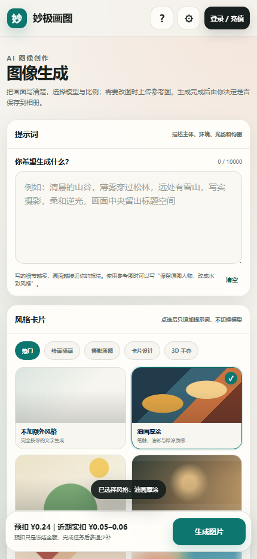

| 生成设置与结果 | 设置与更新 |
| --- | --- |
| 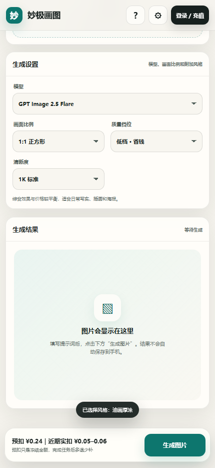 | 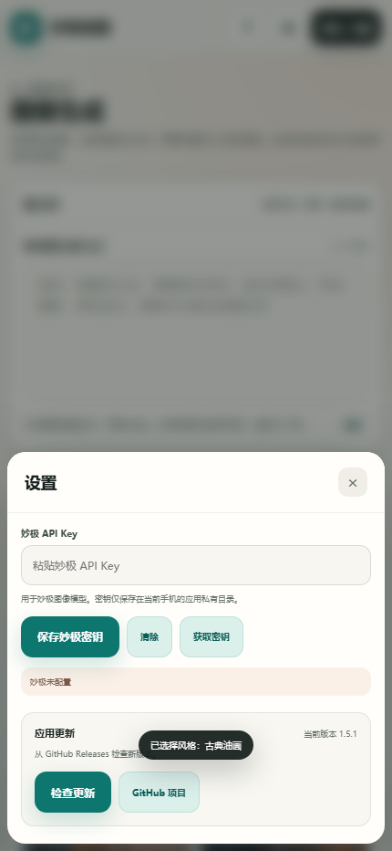 |

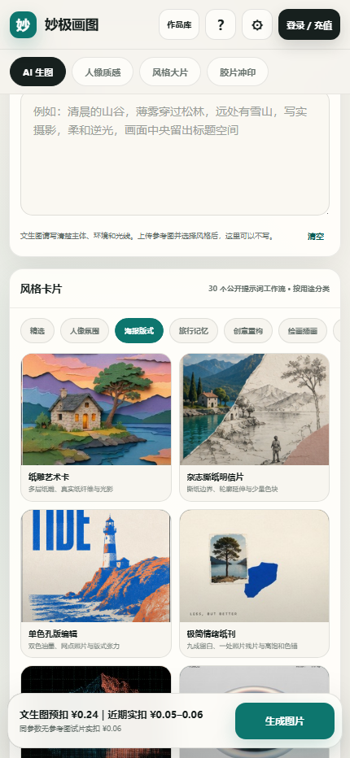

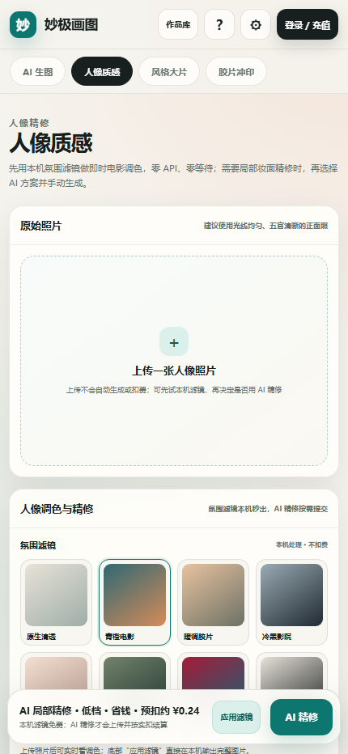

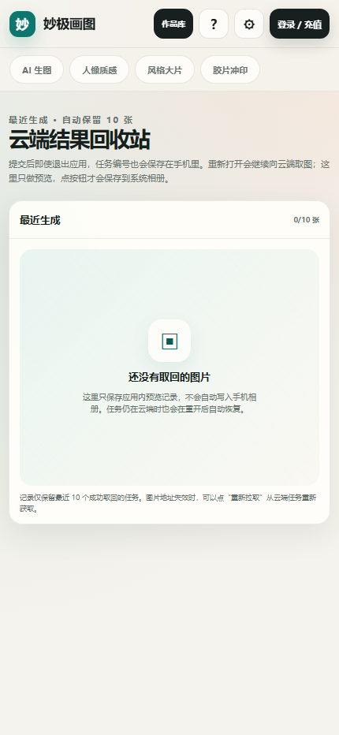

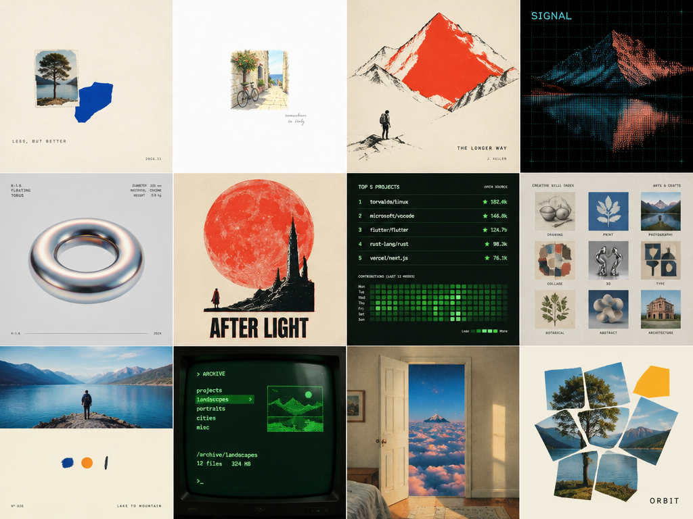

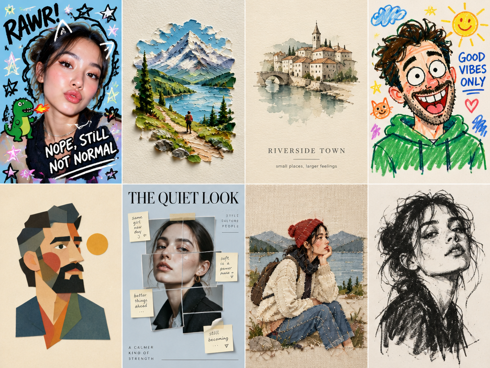

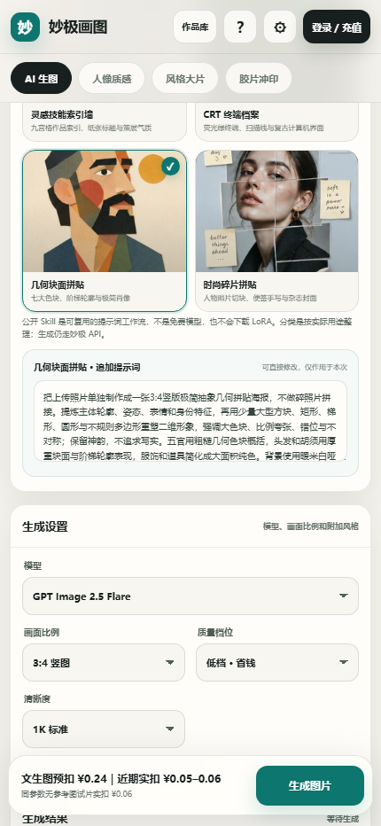

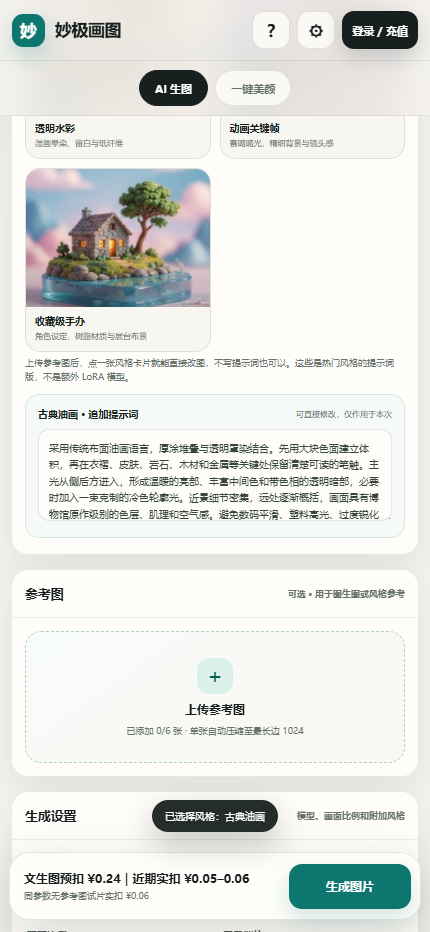

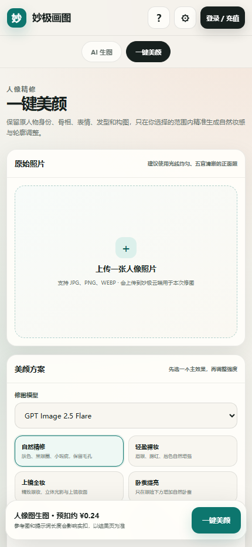

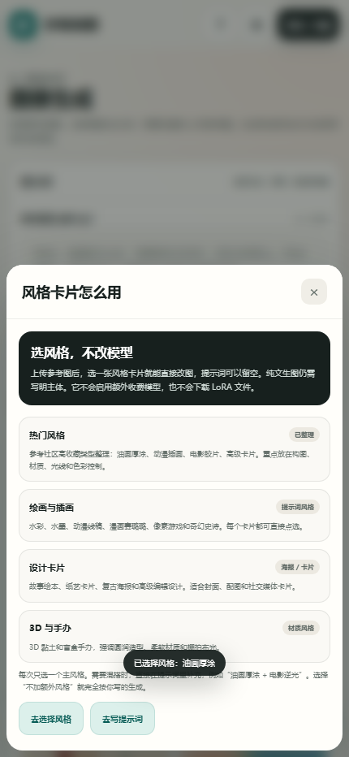

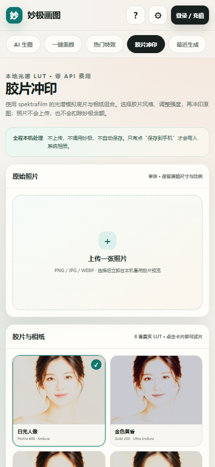

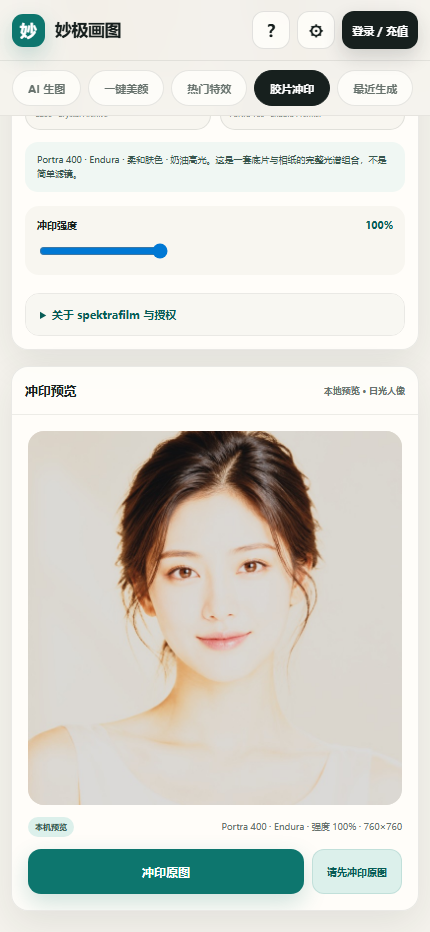

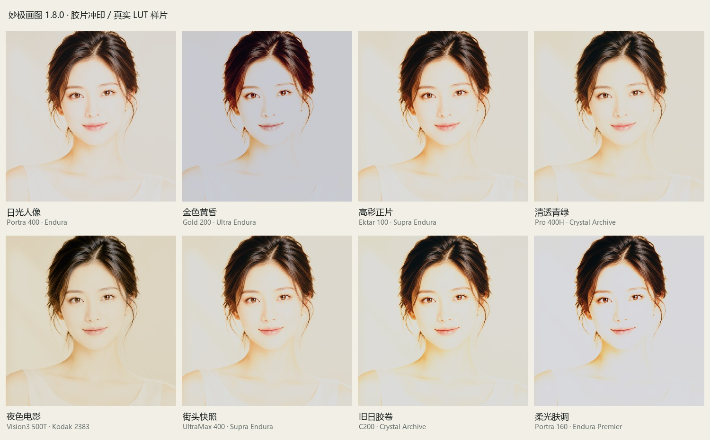

## 构建

需要 Android SDK、JDK 17 和 PowerShell。

```powershell
powershell -ExecutionPolicy Bypass -File .\android\build.ps1
```

构建脚本输出签名 APK 到 `android\build\`。

## 安全

- API Key 只保存在 Android 应用私有目录。
- 仓库和 APK 不包含妙极密钥。
- 支付跳转到妙极官网，应用不收集支付信息。

## 许可

应用代码采用 MIT 许可。

“公开 Skill”指可复用的提示词工作流，不是免费模型额度、LoRA 权重或第三方生成服务。应用始终调用妙极 API，风格卡片只追加提示词。“旅行贴纸卡”参考的公开仓库仅限个人非商业使用，并限制未经许可再分发模板与社区资源；本应用没有复制其 `SKILL.md`，而是依据公开分享图和视觉规则独立重写提示词。

“胶片冲印”板块的 8 套 LUT 派生自
[spektrafilm](https://github.com/andreavolpato/spektrafilm)，原作者为
Andrea Volpato，按 CC BY-SA 4.0 许可使用。派生 LUT 数据继续适用
CC BY-SA 4.0；详见
[OPEN_SOURCE_CREDITS.md](OPEN_SOURCE_CREDITS.md) 和应用内署名。
